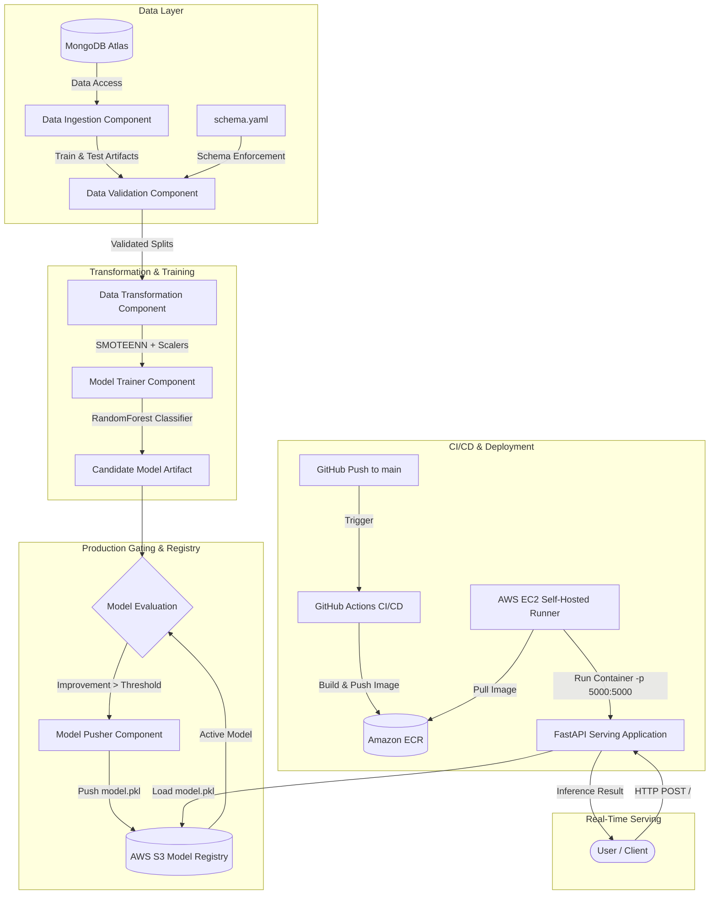

# 🚗 Vehicle Insurance Cross-Sell MLOps Platform

<p align="center">
  <em>An enterprise-grade, end-to-end MLOps platform for real-time customer conversion prediction, featuring automated CI/CD workflows, S3 model versioning, Docker containerization, and AWS EC2 cloud deployment.</em>
</p>

<p align="center">
  
  
  
  
  
  
  
  
  
  
</p>

---

## 📌 1. Project Overview & Business Value

### The Business Challenge
In the insurance industry, customer acquisition costs (CAC) continue to escalate. When health insurance providers seek to cross-sell vehicle insurance policies to existing customers, blanket outbound telemarketing and email campaigns yield sub-optimal conversion rates, strain operational resources, and risk customer fatigue.

### The Solution & ROI
This platform implements an automated, production-ready machine learning system that predicts whether an existing policyholder will subscribe to vehicle insurance (`Response = 1`). 

* **Targeted Customer Outreach**: Empowers sales and underwriting teams to focus on high-propensity leads.
* **Cost Reduction**: Significantly decreases telemarketing and digital ad expenditure by eliminating cold solicitations.
* **Continuous Retraining**: Accommodates shifts in customer behavior and macro trends via automated retraining pipelines.
* **Low-Latency Serving**: Delivers real-time inference via an optimized FastAPI application integrated with a modern web interface.

---

## 🏗️ 2. MLOps Architecture & System Design

The platform follows a decoupled, modular design pattern separating pipeline stages into standalone components governed by centralized configurations and immutable artifact entities.




### End-to-End Pipeline Breakdown
1. **Data Ingestion**: Securely extracts raw data from MongoDB Atlas, performs stratified train/test partitioning, and dumps data into an immutable local feature store.
2. **Data Validation**: Enforces column structure, data types, and value bounds against [`config/schema.yaml`](file:///config/schema.yaml) to preempt data drift and corruption.
3. **Data Transformation**: Employs a hybrid `ColumnTransformer` (`StandardScaler` for continuous features, `MinMaxScaler` for skewed premiums, and one-hot encoding). Resolves extreme class imbalance via `SMOTEENN` (Synthetic Minority Over-sampling + Edited Nearest Neighbors).
4. **Model Training**: Fits a tuned `RandomForestClassifier` on transformed features, generating performance metrics (`Accuracy`, `F1-score`, `Precision`, `Recall`).
5. **Model Evaluation & Gating**: Compares candidate model score against the active production model fetched from AWS S3. Promotion occurs strictly if the candidate exceeds production performance by `MODEL_EVALUATION_CHANGED_THRESHOLD_SCORE`.
6. **Model Pusher**: Deploys approved models directly into the production S3 bucket registry.
7. **CI/CD Automation**: GitHub Actions builds the Docker image, uploads it to Amazon ECR, and orchestrates deployment on an AWS EC2 instance running a persistent self-hosted runner.

---

## 🧰 3. Tech Stack & Cloud Services

| Domain | Technology / Service | Description |
| :--- | :--- | :--- |
| **Machine Learning** | `scikit-learn`, `imblearn` | `RandomForestClassifier`, pipeline transformers, `SMOTEENN` imbalance handling |
| **Data Processing** | `pandas`, `numpy` | High-performance feature engineering and array transformations |
| **Backend & Serving** | `FastAPI`, `Uvicorn` | Asynchronous RESTful API framework and ASGI web server |
| **Web Presentation** | `Jinja2`, `HTML5/CSS3` | Server-side rendered prediction UI and dynamic form interaction |
| **Database** | `MongoDB Atlas` | Cloud NoSQL document database hosting customer raw records |
| **Model Registry** | `AWS S3` | Versioned object storage for trained model artifacts (`model.pkl`) |
| **Containerization** | `Docker` | Multi-stage, reproducible application containerization |
| **Container Registry** | `Amazon ECR` | Secure, private Docker container registry |
| **Cloud Compute** | `AWS EC2 (Ubuntu 24.04)` | Scalable virtual server hosting the deployed web container |
| **Automation & CI/CD** | `GitHub Actions` | Automated build, test, and self-hosted runner continuous deployment |

---

## ⚡ 4. Key Engineering Highlights

* **Production-Gated Model Registry**: Models are never pushed to production blindly. The `ModelEvaluation` component benchmarks candidate metrics against the active S3 production baseline, guaranteeing zero performance regression.
* **Enterprise Architectural Patterns**: Structured around clean architecture paradigms (`constants`, `config_entity`, `artifact_entity`, `components`, and `pipelines`), ensuring clean separation of concerns and maintainability.
* **Imbalanced Dataset Handling**: Real-world cross-sell datasets suffer from severe class skew. The pipeline integrates `SMOTEENN` to synthesize minority class samples while removing borderline noisy data points.
* **Persistent Self-Hosted CI/CD Deployment**: Utilizes a hardened `systemd` background runner daemon on AWS EC2 that autonomously pulls newly published ECR images and restarts containers with zero developer intervention.
* **Defensive Networking & Binding**: Configured for robust container networking, binding to `0.0.0.0:5000` internally with mapped external port routing and firewall ingress rules.

---

## 🚀 5. Quick Start & Local Execution

### Prerequisites
* Python 3.10+
* Conda or `venv`
* Docker Engine
* AWS Account (S3, ECR, EC2 access)
* MongoDB Atlas Cluster

### Step 1: Clone the Repository
```bash
git clone https://github.com/arpit4101/Vehicle-Insurance-MLOPS-Project.git
cd Vehicle-Insurance-MLOPS-Project
```

### Step 2: Environment Configuration
Create a `.env` file in the root directory:
```bash
# AWS Credentials
AWS_ACCESS_KEY_ID="your_aws_access_key_id"
AWS_SECRET_ACCESS_KEY="your_aws_secret_access_key"
AWS_DEFAULT_REGION="us-east-1"

# MongoDB Credentials
MONGODB_URL="mongodb+srv://<username>:<password>@cluster0.mongodb.net/?retryWrites=true&w=majority"
```

### Step 3: Install Dependencies
```bash
# Using conda
conda create -n vehicle python=3.10 -y
conda activate vehicle

# Install project and dependencies
pip install -r requirements.txt
pip install -e .
```

### Step 4: Run Application Locally
```bash
python app.py
```
* Access the web UI at: **`http://localhost:5000`**
* Trigger model training locally: **`http://localhost:5000/train`**

---

## 🐳 6. Docker & Cloud Deployment

### Local Docker Build & Run
```bash
# 1. Build the Docker image
docker build -t vehicle-insurance-app:latest .

# 2. Run container with environment injection
docker run -d \
  --name vehicle-app \
  -p 5000:5000 \
  -e AWS_ACCESS_KEY_ID="your_aws_access_key" \
  -e AWS_SECRET_ACCESS_KEY="your_aws_secret_key" \
  -e AWS_DEFAULT_REGION="us-east-1" \
  -e MONGODB_URL="your_mongodb_url" \
  vehicle-insurance-app:latest
```

### Continuous Deployment via GitHub Actions & AWS EC2
This repository is configured with a fully automated CI/CD pipeline in [`.github/workflows/aws.yaml`](file:///.github/workflows/aws.yaml).

<details>
<summary><b>Click to expand: AWS EC2 Self-Hosted Runner Setup Guide</b></summary>

1. **Launch EC2 Instance**:
   * AMI: Ubuntu 24.04 LTS (T2.Medium or higher recommended)
   * Storage: 30 GB gp3
   * Security Group: Allow Inbound Custom TCP on port `5000` (Source: `0.0.0.0/0`) and SSH on port `22`.

2. **Install Docker on EC2**:
   ```bash
   sudo apt-get update -y
   curl -fsSL https://get.docker.com -o get-docker.sh
   sudo sh get-docker.sh
   sudo usermod -aG docker ubuntu
   newgrp docker
   ```

3. **Register GitHub Self-Hosted Runner as a Background Service**:
   ```bash
   mkdir actions-runner && cd actions-runner
   # Download runner package (URL provided in repo Settings -> Actions -> Runners)
   curl -o actions-runner-linux-x64.tar.gz -L <GITHUB_RUNNER_DOWNLOAD_URL>
   tar xzf actions-runner-linux-x64.tar.gz

   # Configure runner
   ./config.sh --url https://github.com/arpit4101/Vehicle-Insurance-MLOPS-Project --token <RUNNER_TOKEN>

   # Install & start persistent systemd daemon
   sudo ./svc.sh install
   sudo ./svc.sh start
   sudo ./svc.sh status
   ```

4. **Add GitHub Secrets**:
   Under GitHub Repository $\rightarrow$ **Settings** $\rightarrow$ **Secrets and variables** $\rightarrow$ **Actions**, define:
   * `AWS_ACCESS_KEY_ID`
   * `AWS_SECRET_ACCESS_KEY`
   * `AWS_DEFAULT_REGION`
   * `ECR_REPO`
   * `MONGODB_URL`
</details>

---

## 🔌 7. API Reference

| Endpoint | Method | Content-Type | Description |
| :--- | :--- | :--- | :--- |
| `/` | `GET` | `text/html` | Serves the interactive prediction web form |
| `/` | `POST` | `application/x-www-form-urlencoded` | Ingests applicant features and outputs prediction |
| `/train` | `GET` | `text/plain` | Triggers the complete training pipeline asynchronously |

### Request Payload (`POST /`)
```json
{
  "Gender": 1,
  "Age": 28,
  "Driving_License": 1,
  "Region_Code": 28.0,
  "Previously_Insured": 0,
  "Annual_Premium": 2630.0,
  "Policy_Sales_Channel": 152.0,
  "Vintage": 180,
  "Vehicle_Age_lt_1_Year": 1,
  "Vehicle_Age_gt_2_Years": 0,
  "Vehicle_Damage_Yes": 1
}
```

### Prediction Output
```json
{
  "status": true,
  "context": "Response-Yes"
}
```
*(Rendered on the web interface as `Result: Response-Yes` or `Result: Response-No`)*

---

## 📁 8. Repository Structure

```text
Vehicle-Insurance-MLOPS-Project/
├── .github/
│   └── workflows/
│       └── aws.yaml                # GitHub Actions CI/CD configuration
├── config/
│   ├── model.yaml                  # Model hyperparameters
│   └── schema.yaml                 # Dataset schema & feature validation specs
├── src/
│   ├── cloud_storage/
│   │   └── aws_storage.py          # S3 client and object management
│   ├── components/
│   │   ├── data_ingestion.py       # MongoDB sync & dataset splitting
│   │   ├── data_validation.py      # Schema and data drift checking
│   │   ├── data_transformation.py  # Feature scaling and SMOTEENN balancing
│   │   ├── model_trainer.py        # Model training & evaluation metrics
│   │   ├── model_evaluation.py     # Production model benchmarking
│   │   └── model_pusher.py         # S3 production model deployment
│   ├── configuration/
│   │   ├── aws_connection.py       # AWS credentials & session management
│   │   └── mongo_db_connection.py  # MongoDB Atlas connector
│   ├── constants/
│   │   └── __init__.py             # Central pipeline constants and ports
│   ├── entity/
│   │   ├── artifact_entity.py      # Immutable component output dataclasses
│   │   ├── config_entity.py        # Configuration parameter dataclasses
│   │   ├── estimator.py            # Custom model wrapper class
│   │   └── s3_estimator.py         # S3-backed prediction estimator
│   ├── exception/
│   │   └── __init__.py             # Custom error handling with traceback
│   ├── logger/
│   │   └── __init__.py             # Timestamps & file logging config
│   ├── pipline/
│   │   ├── prediction_pipeline.py  # Real-time feature preprocessing & inference
│   │   └── training_pipeline.py    # Orchestration of all component stages
│   └── utils/
│       └── main_utils.py           # Serialization, YAML, and array helpers
├── static/
│   └── css/
│       └── style.css               # Web interface styling
├── templates/
│   └── vehicledata.html            # Jinja2 frontend template
├── Dockerfile                      # Application container definition
├── requirements.txt                # Production Python dependencies
├── setup.py                        # Local module packaging configuration
└── app.py                          # FastAPI ASGI application entrypoint
```

---

## 👤 Author

**Arpit Parmar**  
* GitHub: [@arpit4101](https://github.com/arpit4101)  
* Email: arpit4101@gmail.com  
